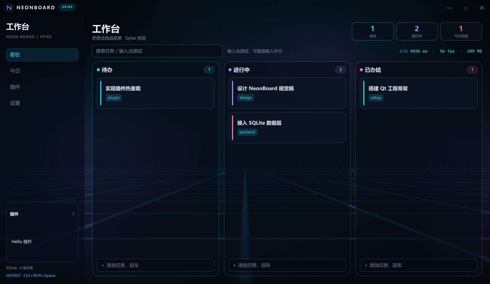

# NeonBoard

个人工作台：赛博霓虹风格的三列任务看板。Qt 6.8 + QML + C++20，本地 SQLite 存储。




## 下载安装

| 方式 | 文件 | 说明 |
| --- | --- | --- |
| **安装版（推荐）** | [`NeonBoard-Setup-<版本>.exe`](https://github.com/Reance195/NeonBoard/releases/latest) | 双击安装，开始菜单启动，支持静默自动更新 |
| **便携版** | [`NeonBoard-<版本>-portable.zip`](https://github.com/Reance195/NeonBoard/releases/latest) | 解压即用，可放 U 盘，不写系统目录 |

- 系统要求：Windows 10 1809 及以上（x64）
- 首次启动约 5–9 秒（Splash 先出现），之后热启动稳定在 1.2–1.4 秒
- 安装包未签名，SmartScreen 提示时选「更多信息 → 仍要运行」
- 数据存于 `%APPDATA%\com.lin\NeonBoard\board.db`，升级与卸载都不会丢

### 30 秒上手

1. 启动后空看板会弹出三步引导，可一键载入三张示例卡
2. 直接输入 `明天 15:00 #工作 !3` 回车，日期 / 标签 / 优先级自动解析
3. 常用快捷键：`Ctrl+K` 命令面板、`Ctrl+Shift+F` 专注计时、`Ctrl+Z` 撤销

> 从源码构建见 [AGENTS.md](AGENTS.md)；插件开发见 [docs/plugin-api.md](docs/plugin-api.md)。

## 功能

- 待办 / 进行中 / 已办结三列看板，SQLite 本地持久化
- 快速添加（Enter）、双击编辑、优先级、标签、截止日期
- 统一新建入口：标题栏「＋ 新建」或 `Ctrl+N` 打开弹窗，可选目标列、挂父卡，并实时预览日期 / 优先级 / 标签解析结果；列底快速添加保留
- 快速录入解析：直接输入 `明天 15:00 #工作 !3`，自动拆出到期时间、标签与优先级，输入时下方实时预览解析结果
- 任务提醒：编辑任务里设「提醒时间」（留空则逾期时提醒一次），到点托盘通知 + 窗口边缘辉光脉冲；应用没跑期间到期的启动后补发，`notified_at` 防重复通知
- 重复任务：编辑任务里选「每天 / 每周 / 每月」或手填 RRULE（如 `FREQ=DAILY;INTERVAL=2`），完成时自动派生下一期（继承标题/备注/优先级/标签/提醒偏移），卡片带 ↻ 标识；派生卡进撤销栈，撤销完成连带删除
- 命令面板 `Ctrl+K`：一条输入框搞定新建任务、按标题跳转到卡片、切换 6 套主题、按阶段过滤、打开插件库 / 设置 / 外观面板、调用插件命令
- 搜索、统计芯片、完成 / 恢复 / 删除
- 键盘导航与无障碍：`Alt+1/2/3` 聚焦列、上下选卡、左右跨列，回车编辑 / 空格完成 / Delete 删除；卡片带 `Accessible.name` 与状态描述，焦点与选中态可被读屏识别
- 活跃热力图：近 13 周每日完成量以霓虹格阵呈现，配连续完成天数、单日峰值与近 8 周吞吐曲线
- 专注计时：`Ctrl+Shift+F` 或标题栏「专注」按 25 / 45 / 60 分钟起一轮，右下角倒计时环显示剩余时间，可暂停 / 继续 / 提前结束；托盘 tooltip 同步剩余时间，倒计时结束托盘提醒并在背景爆发一次脉冲
- 删除后 5 秒内可撤销，或按 `Ctrl+Z`
- 通用撤销：删除 / 移动 / 完成 / 恢复 / 拖拽改位 / 编辑保存全部进同一条撤销栈，`Ctrl+Z` 或提示条「撤销」逐步回退（最多 50 步）
- 卡片拖拽跨列移动 + 列内精确插位（拖到任意两张卡之间，霓虹插入指示线实时标出落点）
- 无边框窗口、自绘标题栏、霓虹 Shader 背景、玻璃卡片
- Shader 场景化：进行中列越满，背景网格流速越快；勾选完成时背景爆发一次能量脉冲；专注模式（`Ctrl+Shift+F`）压暗背景、只留一束跟随鼠标的追光
- 外观面板：6 套主题预设（霓虹青 / 赛博紫 / 落日橙 / 深海蓝 / 森野绿 / 极夜灰），切换即全应用（含霓虹背景）渐变
- 画质三档（低 / 中 / 高）控制背景特效密度与刷新率，另有「减弱动效」开关
- 动效链：卡片滑入进场、悬停浮起、按下微沉、拖起放大、拖入目标列边框呼吸、落位涟漪、勾选完成光扫、删除故障抖动、撤销滑回、逾期呼吸描边、统计数字滚动
- 启动 Splash，主界面加载期间先显示品牌启动图
- 设置 / 插件 / 外观三个面板改为按需加载，首帧不再为空面板付出代价（QML 树构建耗时下降约 250–490 ms）
- 三个面板互斥：同一时刻只显示一个；点击外观面板外部区域即关闭
- 里程碑进度条：按 R0 / R1 / R2 / R3 聚合看板完成度，一眼看出哪个阶段收口了；点击阶段即按阶段过滤看板
- 路线图双向绑定：仓库 `progress.json` 与本地看板自动同步（启动拉取、看板改动写回、提交钩子投递）
- 看板状态派生：卡片状态不再手写，由 `git` 提交信息里的 `#R1-03=done` 与台账 `docs/board-ledger.json` 共同推导，CI 在主线合并后自动回写快照并校验一致性（详见 [docs/board-sync.md](docs/board-sync.md)）
- 主任务 / 子任务关联：子卡自动缩进并标注「↳ 父卡标题」，父卡右下角显示子任务完成度进度环；关联关系存本地边表，不改任务表结构
- agent 领用可见：看板自动扫描锚点与各 worktree 台账里的任务领用，卡片显示 `◈ agent` 标记；仍活跃的领用会自动把卡从「待办」转到「进行中」，分支合并后标记转灰。agent 只负责领任务、干活、提交，状态由看板接管
- 系统托盘、全局热键、开机自启、单实例、窗口位置记忆
- 运行时 QML 插件：权限清单、独立存储、宿主任务 API
- 插件平台 2.0：apiVersion 2 支持后台常驻插件、事件订阅、meta 共享配置、设置页、侧栏 / 底部 / 卡片三种槽位、命令与快捷键注册、权限授权弹窗、插件启停与热重载；插件目录热插拔，新增 / 覆盖 / 删除插件后自动重扫重载，无需重启
- 计划钩子：提交信息里写 `#T12`，标题带 `#T12` 的任务自动转到「进行中」（`#T12=done` / `#T12=todo` 同理，`#R3-01` 这类连字符路线图短号同样生效），详见 [docs/plan-hook.md](docs/plan-hook.md)
- 数据导入导出与自动备份：JSON / Markdown / Todo.txt 三种格式，设置面板一键导出、选择文件导入；每天首次启动自动把 `board.db` 备份一份到 `backups/` 目录
- 软件自动更新：启动后静默检查（最长 20 小时一次）、设置面板手动检查、命令面板「检查软件更新」；下载后先验 SHA-256 再落地 —— 安装版走静默升级，便携版由自更新脚本在程序退出后替换文件并重新拉起。清单为仓库 `update.json`（Gitee → GitHub 兜底），拉不到时回退 GitHub Releases API，详见 [docs/auto-update.md](docs/auto-update.md)
- 数据可靠性：SQLite 走 WAL（读写并发、异常退出不易损坏），启动时 `PRAGMA quick_check` 做完整性校验；检测到库文件损坏会自动备份为 `board.db.corrupt-<时间戳>` 并重建空库，弹窗告知备份路径；早期版本的库（`user_version=0`）打开时自动迁移，已有数据保留
- 插件库：侧栏汇总「已装 / 可装」插件，支持打开、启用、禁用、安装、卸载、更新
- 多市场源：支持仓库简写（Gitee → GitHub 自动回退）、完整地址与本地目录，多源并列合并、同 id 取高版本，并可从 `.neon` 链接直接安装
- 在线市场：按 JSON 索引拉取 `.neon` 单文件插件包，SHA-256 校验后原子安装；断网时自动降级到本地缓存索引
- 预览中心（多代理开发）：主线侧栏「预览」实时列出所有 worktree（分支 / HEAD / 脏状态 / 是否已构建 / 是否在跑），一键构建、启动、停止各 agent 的预览实例；预览实例跑在各自 worktree 的沙箱里，与真实数据完全隔离，窗口标题带 agent 标签便于区分。面板还可把某个工作区「出包」：构建 → 复制 exe 与示例插件 → `windeployqt` 部署运行库，产物落 `dist/packages/<agent>/`，多个出包任务按队列串行执行（不占用当前安装目录）
- 首启动引导：空看板首次启动弹出三步引导（快速录入 → 拖拽换列 → 安装插件），可一键载入三张示例卡试手；「跳过」或完成后再不打扰，已有卡片的老用户不会弹

## 快捷键

| 快捷键 | 作用 |
| --- | --- |
| `Ctrl+Shift+Space` | 全局显示 / 隐藏窗口 |
| `Ctrl+N` | 打开新建任务弹窗 |
| `Ctrl+K` | 呼出命令面板 |
| `Ctrl+Z` | 撤销上一步操作（删除 / 移动 / 完成 / 编辑） |
| `Ctrl+Shift+F` | 开始 / 结束一轮 25 分钟专注（背景压暗 + 追光 + 倒计时环） |
| `Ctrl+,` | 打开设置 |
| `Enter` | 提交新建任务（弹窗 / 快速添加） |
| `Esc` | 清空搜索 / 关闭弹窗 |
| `Alt+1` / `Alt+2` / `Alt+3` | 聚焦待办 / 进行中 / 已办结列，选中首张卡 |
| `↑` / `↓` | 列内切换选中的任务卡 |
| `←` / `→` | 跨列移动键盘焦点 |
| `Enter`（卡片选中时） | 打开任务编辑 |
| `Space`（卡片选中时） | 完成 / 恢复任务 |
| `Delete`（卡片选中时） | 删除任务（可 `Ctrl+Z` 撤销） |

看板卡片带无障碍语义（`Accessible.name` / `description` / `selected`），读屏软件可朗读任务标题、状态、优先级与到期时间。

插件可以通过 `contributes.commands[].shortcut` 声明自己的快捷键（如 `Ctrl+Shift+T`）；与宿主或其他插件冲突时该快捷键自动禁用，命令仍可从 `Ctrl+K` 命令面板调用。

## 运行

安装版：

```text
dist/NeonBoard-Setup-<版本>.exe
```

便携版：

```text
dist/NeonBoard/NeonBoard.exe
```

数据与日志：

```text
%APPDATA%\com.lin\NeonBoard\board.db
%APPDATA%\com.lin\NeonBoard\neonboard.log
```

插件目录：

```text
%APPDATA%\com.lin\NeonBoard\plugins\<plugin-id>\   ← 用户安装区（唯一可写）
<安装目录>\plugins\<plugin-id>\                   ← 随安装包分发
<源码目录>\plugins\<plugin-id>\                   ← 官方插件（只读）
<源码目录>\plugins-samples\<plugin-id>\           ← 示例插件（只读）
```

扫描按上面的顺序进行，靠前优先、同 id 只保留第一个 —— 所以把插件放进用户安装区即可覆盖内置版本。运行时自动监视这四个源目录：新增、覆盖或删除插件后约 0.4 秒内自动重扫并热重载，无需重启；也可在设置面板点「重新扫描插件」手动触发。

> 官方插件「计划钩子」放在源码目录的 `plugins/`，**不随安装包分发**，需手工复制到用户安装区。

## 开发协作

本仓库采用分支工作流，完整规约见 [AGENTS.md](AGENTS.md)：

- 改动必须在独立分支上完成，分支名带 `feature/` `fix/` `docs/` 等类型前缀
- `main` 禁止直接提交，由 Git 钩子强制拦截
- 改完用 `git merge --no-ff` 合并回 `main`，随后删除分支

一键合并回主分支：

```powershell
pwsh -File scripts/git-done.ps1
```

多个代理（多个 AI 会话）同时改本仓库时，仓库根目录归本人专用，代理一律在 `.worktrees/<agent>/` 下开工：

```powershell
pwsh -File scripts/agent-init.ps1 -Agent agent-c -Branch feature/xxx -Card R3-01  # 开区+领任务：卡片自动转「进行中」
pwsh -File scripts/dev-run.ps1 -Wait -AppArgs --smoke                  # 沙箱运行，不污染真实数据
pwsh -File scripts/preview.ps1 -Action List                            # 看各 agent 工作区/构建/运行状态
pwsh -File scripts/preview.ps1 -Action Package -Agent agent-c          # 把该工作区出成独立运行包
pwsh -File scripts/git-done.ps1 -Branch feature/xxx -RemoveWorktree     # 合并 + 推送 + 回收工作区
pwsh -File scripts/release.ps1                                          # 五道闸门出包
```

> `-Card <路线图短号>` 可省：开区即领用，claims 登记（台账 + 提交信息 `#短号=doing`）让对应卡片自动转「进行中」，
> 分支合并或放弃后登记自动失效回退；结项用提交信息 `#短号=done`。领用以大任务（`R#-#`）为主，
> 子卡（`M##`）仅在父任务无人认领时可单独领。详见 docs/git-workflow.md。
> 领用同时会在服务端占位 `refs/claims/<短号>`（非强推，先占先得），CI 会拒绝没有占位的分支合入；
> 领用需联网，仓库 Ruleset 需禁止 `refs/claims/**` 强推/删除。
>
> 预览中心让「每个 agent 的成果即时可见」：主线实例的侧栏「预览」面板，或上面的 `preview.ps1`，
> 都能直接构建并启动某个 agent 的预览实例，**不必等所有 agent 合并完**。
> 「出包」是面板里的队列动作：同一时间只跑一个，产物在 `dist/packages/<agent>/`，
> 包含 exe、宿主、Qt 运行库、示例插件与 `BUILD-INFO.txt`，不碰正在使用的安装目录。

逐步操作与钩子排查见 [docs/git-workflow.md](docs/git-workflow.md)，贡献约定见 [CONTRIBUTING.md](CONTRIBUTING.md)。

## 开发构建

依赖：Qt 6.8.3 MSVC 2022 x64、Visual Studio 2022 BuildTools、CMake 3.21+。

一键构建（默认 **Ninja** 生成器，增量更快、可配合 sccache；自动探测 CMake / Qt / Ninja，可选构建后自检）：

```powershell
pwsh -File scripts/build.ps1                 # Release 构建（Ninja）
pwsh -File scripts/build.ps1 -SelfTest       # 构建后跑 --selftest（沙箱数据目录）
pwsh -File scripts/build.ps1 -Config Debug -Clean
pwsh -File scripts/build.ps1 -Generator VS   # 回退 Visual Studio / MSBuild 生成器
```

- 生成器：默认 **Ninja**（单配置，exe 落在 `build/` 根）；不在 MSVC 开发者环境时脚本会自动定位并导入 `vcvars64`，探测不到 Ninja 时自动回退 VS。
- 编译缓存：本机装有 `sccache` 时由 CMake 自动启用（跳过未变动的翻译单元重编），无需额外配置。

常用参数：`-QtRoot <路径>` 指定 Qt、`-BuildDir` 换输出目录、`-Generator Ninja|VS` 选生成器、`-Reconfigure` 强制重新配置、`-Jobs N` 限制并行度、`-Target NeonBoardHost` 只构建子目标。

### 单元测试

纯逻辑层（快速录入解析、插件包校验/安装）用 Qt Test 覆盖，由 CTest 统一调度。
测试目标默认随构建一起编译（`BUILD_TESTING` 默认 ON），编译不过即等于门禁失败。

```powershell
pwsh -File scripts/build.ps1 -SelfTest          # 构建 + 自检
ctest --test-dir build -C Release --output-on-failure   # 跑单元测试
ctest --test-dir build -C Release -R taskinputparser -V  # 只跑单个用例并看详细输出
```

- 用例位置：`tests/`，命名 `tst_<模块>.cpp`，在 `tests/CMakeLists.txt` 用 `neonboard_add_test(<模块>)` 登记。
- 收录原则：只收**不依赖数据库 / 窗口 / QML 引擎**的纯逻辑模块，保证无时序抖动；涉及 `Database` 的门面后续按同样方式建独立临时库测试。
- 断言基准时间固定（如 `2026-10-25 10:00`），相对日期与「已过时刻顺延」等规则跨机器可复现。
- 新增测试后用 `-DBUILD_TESTING=OFF` 可跳过，仅出包时使用。
- CI 门禁顺序：**编译 → 单元测试 → 数据库自检 → 冒烟启动 → 看板一致性**，任一步失败即阻断合入。

### Windows 原生集成

- **应用标识**：启动即设置 AppUserModelID（`com.lin.neonboard`），任务栏分组与通知归属才对得上；安装器写快捷方式必须用同一值。
- **`.neon` 文件关联**：`NeonBoard.exe --register-file-assoc` 注册（只写 HKCU、无需管理员），之后双击插件包即安装；`--assoc-status` 查看、`--unregister-file-assoc` 还原。
- **跳转列表**：任务栏右键「新建任务 / 搜索命令面板 / 插件库 / 偏好设置」，参数复用冷启动开关，点击与命令行启动走同一条代码路径。
- **二次启动带动作**：应用已在运行时再执行 `NeonBoard.exe --palette 周报`，不会开第二个进程，而是把动作转给主实例并直接弹出命令面板。

细节、注册表键位与未实现项（WinRT 富通知）见 [docs/windows-integration.md](docs/windows-integration.md)。

VS / MSBuild 生成器（多配置，exe 落在 `build/Release/`）的手敲等价命令：

```powershell
cmake -S . -B build -G "Visual Studio 17 2022" -A x64 `
  -DCMAKE_PREFIX_PATH=C:/Qt/6.8.3/msvc2022_64 -DBUILD_TESTING=ON
cmake --build build --config Release
ctest --test-dir build -C Release --output-on-failure
```

生成便携目录：

```powershell
powershell -ExecutionPolicy Bypass -File scripts/deploy.ps1
```

生成安装包：

```powershell
& "ISCC.exe" installer\neonboard.iss   # ISCC 需在 PATH 中，或写 ISCC 安装目录下的绝对路径
```

调试参数：

```text
--selftest   数据库增删改查自检
--smoke      启动 4 秒后输出指标并退出（不占用单实例锁）
--benchload [minimal|controls|button]
             分档加载探针界面，量化启动各段开销
--settings   启动后打开设置
--plugins    启动后打开插件面板
--appearance 启动后打开外观面板（主题 / 画质 / 减弱动效）
--palette [query]
             启动后打开命令面板，可带预填关键字
--plugin-report
             输出插件平台清单（插件 / 命令 / 槽位 / 设置页 / 授权缺口）JSON 到标准输出
--stage <R0|R1|R2|R3>
             启动后按里程碑过滤看板（不填则显示全部）
--sync-roadmap [path]
             从路线图快照导入看板（默认取仓库 progress.json）
--export-roadmap [path]
             把看板现状写回路线图快照
--newtask    启动后打开新建任务弹窗
--autostart  静默启动到托盘
--emit-hook <text>
             把一段文本当作提交信息投递给计划钩子（只投递，规则由插件执行）
--emit-hook-file <path>
             同上，从 UTF-8 文件读提交信息（推荐，避免命令行转义问题）
--library    启动后打开插件库
--install-plugin-file <path>
             从本地 .neon 包安装插件（原子安装，退出码 0 成功 / 2 失败）
--market-source <spec>
             设置插件市场源（可重复多次或用逗号分隔；spec 支持 owner/repo 简写、
             完整 market.json 地址、本地目录；同时写入 meta，可离线复用）
--market-sources
             列出当前已配置的市场源
--market-refresh
             拉取所有启用源的市场索引并合并（失败时降级到本地缓存，退出码 0 成功 / 2 失败）
--market-install <id>
             从市场安装指定插件（校验 SHA-256 后原子安装）
--install-plugin-url <url>
             直接从 .neon 包链接安装（可加 #sha256=... 指定校验值，退出码 0 成功 / 2 失败）
--export-tasks [path] [format]
             导出任务数据（format 取 json / markdown / todo，缺省用数据目录下的默认文件名）
--import-tasks <path> [format]
             导入任务数据（format 取 auto / json / markdown / todo，按标题匹配已有任务）
--backup   立即把当前 board.db 备份到 backups/ 目录
--check-update
             检查一次软件更新，打印当前版本 / 最新版本 / 安装形态 / 状态
--update-apply
             检查→下载→校验→静默安装一次跑完（无人值守升级，退出码 0 已启动安装 / 2 失败）
--update-source <url|owner/repo|本地路径>
             设置更新清单源（同时写入设置，可离线复用）
--update-sources
             列出当前已配置的更新清单源
```

环境变量：

```text
NEONBOARD_NO_BG=1   关闭动态霓虹背景（低配 / 排障）
NEONBOARD_ROADMAP   路线图快照路径（默认自动探测仓库内 progress.json）
NEONBOARD_ROADMAP_AUTOWRITE=0
                    关闭「看板改动自动写回快照」
NEONBOARD_DATA_DIR  覆盖数据目录（数据库 / 插件 / 日志 / 界面设置全部落到该目录，
                    用于多实例隔离与排障）
NEONBOARD_INSTANCE  单实例标识后缀，允许同机多开（配合 NEONBOARD_DATA_DIR）
NEONBOARD_QT_BIN    Qt 运行库目录，供 Git 钩子在开发版 exe 上补齐 PATH
```

## 项目结构

```text
src/                 C++：数据库、模型、托盘、热键、窗口、插件宿主、界面设置、路线图同步、数据导入导出、预览中心、软件更新
qml/                 QML：主界面、霓虹背景
  theme/             主题与动效单例（Theme / Motion）
  components/        卡片、看板列、统计芯片、窗口按钮、外观面板、设置面板、插件面板、阶段进度条、预览中心面板
shaders/             GLSL Shader
plugins/             官方插件（只读，需手工复制到用户插件目录）
plugins-samples/     示例插件（只读）
installer/           Inno Setup 脚本
scripts/             构建部署与多代理协作脚本（agent-init / dev-run / preview / release 等）
  derive_board_status.py  看板状态派生器：从提交历史 + 台账推导卡片状态
docs/                截图、迭代路线图与插件文档
docs/board-ledger.json 看板卡片台账（短号 ↔ 卡片 id / 标题 / 初始状态）
docs/board-sync.md   看板状态派生与一致性机制说明
docs/themes/         6 套主题预设实机截图
.github/workflows/   GitHub Actions 持续集成流水线
```

## 宿主进程

托盘常驻与界面渲染拆成两个进程：

| 进程 | 可执行文件 | 职责 | 常驻内存 |
| --- | --- | --- | --- |
| 宿主 | `NeonBoardHost.exe` | Win32 托盘、全局热键 `Ctrl+Shift+Space`、单实例、按需拉起/回收渲染进程 | 约 6 MB |
| 渲染 | `NeonBoard.exe --hosted` | QML 看板界面，关窗后 60 秒无操作自动退出，内存归零 | 约 140 MB（仅展开时） |

`--hosted` 由宿主注入：渲染进程在该模式下不创建系统托盘、不注册全局热键，避免与宿主争抢。
单独运行 `NeonBoard.exe` 仍是完整的单进程模式，行为与之前一致。

安装包与桌面快捷方式启动 `NeonBoardHost.exe --open`（已常驻时直接唤起窗口，否则拉起渲染进程）；
「开机自启」写注册表时也优先指向 `NeonBoardHost.exe`，不再让自启拉起全量 QML 进程。

## 持续集成

仓库内置 GitHub Actions 流水线（`.github/workflows/ci.yml`），推送或合并到 `main` 时自动在 `windows-2022` 上执行：

1. 安装 MSVC 开发环境与 Qt 6.8.3（`install-qt-action`，含 `qtshadertools` addon）
2. `cmake -S . -B build -G "Visual Studio 17 2022" -A x64` 配置并编译 Release
3. `NeonBoard.exe --selftest` 数据库自检
4. `--smoke` 冒烟启动，并扫描运行日志，出现 QML / C++ 错误即判定失败
5. `scripts/deploy.ps1 -SkipBuild` 打包便携版，校验产物存在，并验证便携版可脱离本机 Qt 独立运行
6. 上传便携版产物为构建制品（artifact 名 `NeonBoard-windows-x64`，保留 30 天），可在 Actions 页面直接下载解压使用
7. 看板状态闸门：PR 分支上校验 `progress.json` 的卡片状态与「提交历史 + 台账」是否一致，不一致直接拦住合并；合并到 `main` 后由 CI 自动回写快照状态（特性分支完全不碰 `progress.json`，多代理并行零冲突）

本机运行 exe 时需要 Qt 的 DLL 在 `PATH` 中（CI 里由流水线注入 `$env:QT_ROOT_DIR\bin`）。

本地脚本 `scripts/deploy.ps1` 的工具定位顺序为「环境变量 → PATH → 已知安装路径」，因此在 CI 与本机都能直接运行。

另有出包流水线 `.github/workflows/release.yml`：打 `v*` 标签或手动触发时，在 `windows-2022` 上跑完构建与自检，
用 Inno Setup 生成安装包并上传构建制品；打标签时同时发布 GitHub Release。
发布时还会把便携目录打成 zip、用 `scripts/build-update-manifest.ps1` 生成 `update.json`（含两个产物的 SHA-256），
随 Release 上传并**提交回仓库** —— 客户端默认从 raw 读清单，只挂在 Release 资产上读不到。

## 插件

插件使用 QML 编写，放入插件目录后点「重新扫描插件」生效。详见 [docs/plugin-api.md](docs/plugin-api.md)。

侧栏「插件」卡片即插件库入口：列出**已装**（用户安装区）与**可装**（随包 / 官方 / 示例 / 在线市场）两类插件，可直接打开、启用、禁用、安装、卸载、更新。完整库界面点击「详情」进入，也可按 `Ctrl+,` 打开设置后点「打开插件库」。

当前插件边界：

- 面板插件提供 `main.qml`；`apiVersion: 2` 还能加 `background.qml` 常驻后台
- 每个插件可声明 `settings: "settings.qml"`，自动聚合进设置面板的「插件设置」区
- 槽位：`contributes.slots` 可提供 `sidebar` / `bottom` / `card` 三个界面位（`card` 会接管每张任务卡的扩展区，拿到 `taskId`）
- 命令：`contributes.commands` 声明 `id / title / category / description / shortcut`，进 `Ctrl+K` 命令面板并可注册快捷键
- 支持权限：`storage`、`notifications`、`tasks.read`、`tasks.write`、`openUrl`、`meta`、`events`；新装插件首次调用高危权限时弹窗显式授权，来源与风险一并展示
- 支持事件订阅（任务创建 / 更新 / 移动 / 完成 / 删除、提交投递）
- 支持插件启停、重新扫描（热重载）
- 支持插件库与在线市场：`.neon` 单文件包（JSON）→ SHA-256 校验 → 临时目录原子替换安装
- 不支持插件 HTTP API；插件运行在宿主 QML 引擎内，属于受信插件，不是沙箱
- 示例插件 `plugins-samples/surfaces/` 演示设置页、三种槽位与命令注册

### 在线市场

市场是一个 JSON 索引文件，指向若干 `.neon` 包：

```json
{
  "version": 1,
  "updatedAt": "2026-10-21",
  "plugins": [
    {
      "id": "com.lin.market-demo",
      "name": "市场演示插件",
      "version": "1.0.0",
      "description": "示例",
      "author": "NeonBoard",
      "download": "https://example.com/market-demo.neon",
      "sha256": "1c592a78…",
      "size": 469
    }
  ]
}
```

`.neon` 包本身是一个 JSON 文件，`manifest` 是插件清单，`files` 是文件名到源码文本的映射：

```json
{
  "manifest": { "id": "com.lin.market-demo", "name": "市场演示插件", "version": "1.0.0", "apiVersion": 1, "main": "main.qml" },
  "files": { "main.qml": "import QtQuick\nRectangle { }" }
}
```

安装时依次做四道校验：包格式合法 → `manifest.id` 与请求一致 → SHA-256 与索引一致（索引给了才校验）→ 文件路径不越界（禁绝对路径、反斜杠与 `..`）。全部通过后先落到临时目录，再原子替换目标目录，失败自动回滚。

### 多市场源

市场源可以配多个，**并列生效**：同一个 id 的插件取版本高者，条目上会标出来自哪个源。源地址支持三种写法：

| 写法 | 例子 | 说明 |
| --- | --- | --- |
| 仓库简写 | `owner/neonboard-market` | 客户端依次尝试 Gitee → GitHub 的 `market.json` |
| 完整地址 | `https://host/path/market.json` | 直接拉这个文件 |
| 本地目录 | `D:\market` 或 `file:///D:/market` | 读目录下的 `market.json` |

每个源各自缓存（`market-cache.json` 里按源分条记录，带 ETag / Last-Modified / 拉取时间，TTL 默认 6 小时），断网时各自降级到自己的缓存，互不影响。索引里的 `download` 可以只写文件名，客户端会按索引所在目录解析成完整地址。

插件库面板里可以添加 / 停用 / 删除 / 调整顺序（顺序即优先级），并显示每个源的状态（已更新 / 缓存 / 失败）；也可以直接粘贴 `.neon` 链接安装。

### 发布一个市场源

仓库带发布脚本，把插件目录打成 `.neon` 包并写进市场索引：

```powershell
pwsh -File scripts/publish-market.ps1 -PluginPath plugins\plan-hook `
    -OutputDir D:\market -DownloadBase https://gitee.com/<owner>/<repo>/raw/main
```

脚本会读 `plugin.json`、把插件文件打成单文件 `.neon`、算 SHA-256 与体积、更新 `market.json`（保留其他条目，`signature` 字段位留空待以后接上）。

## 已知限制

- 首次运行受磁盘与页缓存影响，主界面加载约 5–9 秒；之后热启动稳定在 1.2–1.4 秒。Splash 会先显示
- 搜索或按阶段过滤时，拖拽落点按未过滤的列内顺序计算
- 快速录入解析只识别中文与阿拉伯数字的常见写法（今天 / 明天 / 后天 / 下周三 / 15:00 / 3点半 / 下午3点 / #标签 / !1-!3），不解析英文日期与自然语言长句
- 手工改 `progress.json` 时请同步抬高该条目的 `updatedAt`，否则会以看板版本为准
- 撤销栈只保留最近 50 步；插件写入与路线图快照同步不进入撤销栈（避免同步动作污染用户撤销历史）；提醒时间的设置/清除同样不进撤销栈（侧表元数据，与插件写入同口径）
- 提醒按 30 秒轮询粒度触发（到点后最迟 30 秒内通知）；应用完全关闭期间不推送系统通知，启动后补发
- 重复任务 v1 支持 RRULE 子集：`FREQ=DAILY|WEEKLY|MONTHLY|YEARLY` + `INTERVAL=n` + `BYDAY`（仅 WEEKLY）；`COUNT` / `UNTIL` / 其它 BYxxx 暂不支持（规则原样存储，日后扩展不影响数据）；月末自动钳制（1/31 + 1月 = 2/28）
- 安装包未签名，Windows SmartScreen 可能提示
- 更新清单默认源是仓库 raw（Gitee → GitHub），仓库地址未定前请用设置面板或 `--update-source` 改成真实地址；清单签名校验暂未实现（`update.json` 只做 SHA-256 产物校验）
- 便携版自更新依赖系统 `robocopy`，覆盖过程写在 `%TEMP%\neonboard-update.log`；更新只替换程序文件，不动数据目录（`board.db` / 插件 / 设置都不受影响）
- 更新检查在启动后延迟 8 秒且最长 20 小时一次，想立刻确认请用设置面板或 `--check-update`
- Todo.txt 格式只带标题、标签与备注，不含优先级与到期日；需要完整备份请用 JSON 格式
- 导入按标题匹配已有任务（存在则更新），而路线图快照按 id 匹配；若两者同时存在同一张卡，可能各生成一份
- 计划钩子需先把 `plugins/plan-hook` 复制到用户插件目录才会生效；未安装时提交里的 `#T12` 静默失效
- 插件市场默认源是仓库简写（`Reance195/neonboard-market`，索引仓库见 <https://github.com/Reance195/neonboard-market>），Gitee 拉取失败时自动回退 GitHub raw；索引签名校验暂未实现（`signature` 字段位已预留）
- Qt 采用 LGPL 动态链接；再分发时需保留 Qt 动态库与许可说明

## 第三方

Qt 6.8.3（LGPLv3，动态链接）、SQLite（Qt SQL 驱动）。示例插件与界面代码为本项目自有。
