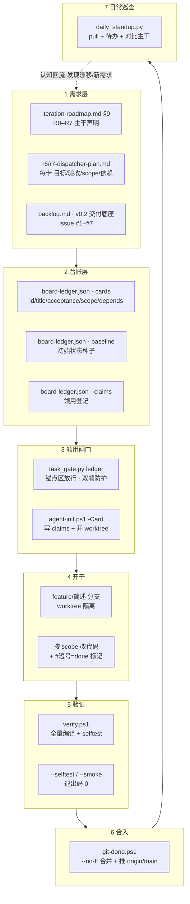

# NeonBoard 项目全景地图（Onboarding）

> ⚠️ **已归档（2026-10-30）**：里程碑状态表已过期（文中 R6「部分完成 3/9」、R7「规划中」，实际均已收官）。
> 现行进度以 [`../iteration-roadmap.md`](../iteration-roadmap.md) §9 与 [`../board-ledger.json`](../board-ledger.json) 为准；本文件仅作历史版本留存。

> 给「第一次接触本项目」的人看的上手地图：项目是啥、怎么切、活怎么流、规矩红线、当前进度、agent 能帮你干啥、你怎么上手。
> 维护方式：随项目演进更新；重大里程碑变动（如新增 R8）请同步 §2 与 §5。
> 本文件本身也是**导航枢纽**——§3 的图把每一环都标到了具体文件 / 脚本 / 卡片，§9–§13 是「想了解 X → 看哪」的钻取索引。

## 1. 这个项目是啥

NeonBoard 是一个 **Qt/QML + C++ 的桌面任务看板**应用，主打"炫酷"体验（动效、主题引擎、Shader 场景化）。
它的核心演进方向是 **任务派发器**：让 agent 能一键把一张"任务卡"真正跑起来，并给出可验证的结论。
你看到的 R0–R7 里程碑，就是奔着「看板 → 可派发 agent 执行的任务系统」去的。

## 2. 项目怎么切（两层）

### 2.1 里程碑 R0–R7（路线图里的"版本/阶段"）

| 版本 | 主题 | 主干状态 | 一句话 | 细节入口 |
|------|------|----------|--------|----------|
| R0 | 炫酷地基 | 完成 | 启动瘦身、主题引擎 v1、动效基线 | `iteration-roadmap.md` §3 |
| R1 | 日常底座 | 完成 | 提醒/逾期、RRULE、子任务、导入导出、Ctrl+K、撤销 | `iteration-roadmap.md` §4 |
| R2 | 记忆点 | 核心完成 | Shader 场景化、专注模式、统计可视化 | `iteration-roadmap.md` §5 |
| R3 | 生态 | 基本完成 | 插件平台 2.0 + 在线市场 + 热重载 | `iteration-roadmap.md` §6 |
| R4 | 工程化底座 | 完成（台账 baseline 陈旧） | Agent 任务桥、Windows 集成、多板、数据可靠性、CI、构建提速、任务治理 | `iteration-roadmap.md` §9 + 见 §13 |
| R5 | 交付与运维 | 完成（R5-05 漂移） | 自动更新、单测 9/9 | `iteration-roadmap.md` §9 |
| R6 | 任务派发器 | 部分完成（3/9） | 执行定义、run 表+锁、Profile+确认、单次执行器、验收器、面板、Triage、Loop | `r6-dispatcher-plan.md` |
| R7 | 派发器进阶 | 规划中（6 卡已登记） | 队列编排 + 多 Agent 角色链（承接 R6 推迟的 M2–M4） | `r7-dispatcher-plan.md` |

详细计划：`docs/r6-dispatcher-plan.md`、`docs/r7-dispatcher-plan.md`；主干声明见 `docs/iteration-roadmap.md` §9。

### 2.2 任务卡（ledger）

每张具体工作 = 一张卡，全部在 `docs/board-ledger.json`：

- `cards`：短号（`R6-01`）、标题、`acceptance[]`（验收命令）、`scope[]`（改动范围）、`depends[]`（依赖）、`note`（背景/交付说明）
- `baseline`：卡片初始状态种子（⚠️ 多处陈旧，真实状态以 git 提交里的 `#短号=done` 标记为准）
- `claims`：谁领用了哪张卡（agent 只能写这里）

> 怎么读 ledger 见 §10；R6-01 / R7-01 的真实片段也在 §10 里，照着看就懂。

## 3. 全链路（从需求到合入）—— 导航版



**钻取注解**（点击/搜索对应节点即可抵达细节）：

| 节点 | 它到底是什么 | 打开 / 运行 |
|------|--------------|-------------|
| A1 | 主干需求声明表 | `docs/iteration-roadmap.md` §9（里程碑行）+ §9.2（R7 说明） |
| A2 | 派发器逐卡规格 | `docs/r6-dispatcher-plan.md`、`docs/r7-dispatcher-plan.md` |
| A3 | 交付底座排期 | `docs/backlog.md`（v0.2 issue #1–#7） |
| B1/B2/B3 | 台账三张表 | `docs/board-ledger.json`（结构见 §10） |
| C1 | 提交前的闸门 | `scripts/task_gate.py`（详见 §11） |
| C2 | 一键领卡+开环境 | `scripts/agent-init.ps1 -Card <短号>` |
| D1 | 隔离的工作区 | `git worktree list` 查看；分支 `feature/<简述>` |
| E1 | 编译+自测 | `scripts/verify.ps1` |
| F1 | 合规合入远程 | `scripts/git-done.ps1` |
| G1 | 一站巡查 | `.workbuddy/skills/neonboard-daily-dev/scripts/daily_standup.py` |

## 4. 宪章红线（AGENTS.md 摘要）

- **不在 `main` 直改直提**：纯文档走 `docs/<描述>` 分支，代码走 `feature/<简述>` 分支
- 提交信息 `<type>(<scope>): 中文简述`；纯文档用 `docs(roadmap):`
- **任务先行**：所有改动必须对应一张已领用的卡，无卡改动会被闸门拦
- **agent 不能自作主张加卡**（那是自授权，闸门退化成自证）；但**维护者显式授权 → agent 可代登记**（R7 六卡即此路径）
- agent 只能写 `claims`（领用）+ `note`（交付说明），不能写 `cards`/`baseline`
- "提上去"的合规路径：`git-done.ps1` 远程模式做 --no-ff 合并 + 快进推 `origin/main`

## 5. 当前真实进度（基于 daily_standup + git 标记核实）

台账共 **72 张卡**。注意：`baseline` 是陈旧种子，真实状态看 git 提交里的 `#短号=done` 标记。

- **R0–R4 基本做完**：R4 全 10 张有 git done 标记，但台账 `baseline` 仍 todo（陈旧）
- **R5 宣称 done，但 `R5-05` 仍 todo**（漂移，待维护者回填）
- **R6 派发器 3/9 已 done**（R6-01/02/03，引擎骨架就绪），正等 **R6-04 单次执行器**这个 MVP 分水岭
- **R7 派发器进阶 6 张卡刚登记**（全 todo），是 R6 收口后的下一步

⚠️ 坑：`baseline` 多处陈旧（R4 全量、R5-05、R6 的 3 张），功能上 git 标记已覆盖，但"对比主干"会误报，需维护者回填。

## 6. agent（WorkBuddy）能帮你干啥

- **日常开发技能**（`.workbuddy/skills/neonboard-daily-dev/`）：说"日常开发"→ 拉代码+分析待办+对比主干
- **代登记卡片**（你授权后）：像 R7 那样追加进 ledger
- **开干一张卡**：你给卡号 → `agent-init` 开 worktree → 实现 → `verify` → `git-done` 合入
- 写/改文档（路线图、计划）、逐文档带读讲解

## 7. 上手三步走

1. **读三份建立认知**（几分钟）：`README.md`（定位）、`AGENTS.md`（宪章红线）、`docs/iteration-roadmap.md`（§9 主干）
2. **跑一次日常技能看活**：直接说"日常开发"，把待办和主干对比拉给你
3. **挑方向**：要么推进 **R6-04**（给 R7 打地基，依赖已就绪），要么让我逐文档带读

## 8. 关键文档索引

- 宪章：`AGENTS.md`
- 里程碑需求：`docs/iteration-roadmap.md`（§9 主干）
- 派发器计划：`docs/r6-dispatcher-plan.md`、`docs/r7-dispatcher-plan.md`
- 交付底座排期：`docs/backlog.md`
- 台账：`docs/board-ledger.json`
- 工作流细节：`docs/git-workflow.md`、`docs/task-card.md`
- 日常技能：`.workbuddy/skills/neonboard-daily-dev/SKILL.md`

---

## 9. 钻取索引：我想了解 X → 看哪 / 跑哪

| 我想了解…… | 去哪 |
|------------|------|
| 整个项目的演进阶段与当前主线 | §2.1 表格 + §5 进度 |
| 某张任务卡到底要干啥、怎么算完成 | `board-ledger.json` 的 `cards[<短号>]`（§10 教你看） |
| 某卡依赖谁、被谁依赖 | 卡片 `depends[]` 字段；或 `daily_standup.py --stage R6` 看聚合 |
| R6 / R7 派发器的完整设计 | `r6-dispatcher-plan.md` / `r7-dispatcher-plan.md` |
| 主干说"做完"了，实际做没做 | 跑 `daily_standup.py`，看 §4「对比主干需求」的漂移标记 |
| 为什么我的提交被拦了 | `scripts/task_gate.py`（§11）+ `AGENTS.md` 条款 6 |
| 怎么领一张卡开始干 | `agent-init.ps1 -Card <短号>`（§11）+ §12 示例 |
| 怎么把活合规"提上去" | `git-done.ps1`（§11） |
| 改代码前该满足哪些验收 | 卡片 `acceptance[]`，用 `verify.ps1` 跑（§11） |
| v0.2 交付底座还差啥 | `docs/backlog.md` |
| 当前有哪些卡可领（待办） | `daily_standup.py` 的「待办建议」或搜 `baseline:"todo"` 且未在 `claims` 的卡 |

## 10. 怎么读 `board-ledger.json`（含真实片段）

文件是标准 JSON，顶层三张表：`cards`、`baseline`、`claims`。**读卡看 `cards`**，下面是两张真实卡（已截断 `note` 长文）：

**R6-01（已 done，执行定义可编辑）**
```json
{
  "acceptance": [
    "ctest --test-dir build -C Release -R tst_taskexec --output-on-failure",
    "build/Release/NeonBoard.exe --selftest 退出码 0",
    "build/Release/NeonBoard.exe --smoke 退出码 0 且无 QML 报错"
  ],
  "id": "90651d45-9baf-4c3a-93a6-2a8d2ff981b5",
  "note": "起因：task_exec 侧表已能存 cwd/timeout_min/max_attempts，但编辑弹窗只暴露 goal/acceptance/scope/agent/workflow……",
  "baseline": "todo"
}
```

**R7-01（刚登记，待开干，队列调度器）**
```json
{
  "id": "8dff38e0-71b9-4f66-9f64-4e088a1e0b90",
  "stage": "R7",
  "title": "R7 执行队列与调度器：FIFO + 并发≤2 + 背压 + 暂停/调序/跳过",
  "note": "起因：R6 忙时直接拒绝，多卡只能一张张手工触发……",
  "acceptance": [
    "ctest --test-dir build -C Release -R tst_scheduler --output-on-failure",
    "build/Release/NeonBoard.exe --selftest 退出码 0 且断言 task_run 新列存在、user_version 未变"
  ],
  "scope": ["src/Database.cpp","src/TaskRunStore.*","src/Scheduler.*","src/main.cpp","tests/tst_scheduler.cpp","tests/CMakeLists.txt","CMakeLists.txt"],
  "depends": ["R6-04","R6-06"]
}
```

**字段速查**
- `acceptance[]`：验收命令，**改完必须全部退出码 0**（CI 与 `verify.ps1` 都按它跑）
- `scope[]`：允许改动的路径；越界改动会被验收器 / ScopeMatcher 标红
- `depends[]`：前置卡；前置没 done 前不应开干（见 §12）
- `note`：背景、决策、已交付内容，是"这张卡为什么存在"的来龙去脉
- `baseline`：仅种子；**判断真状态以 git log 里的 `#短号=done` 为准**

## 11. 脚本 / 命令详解

| 命令 | 何时用 | 输入 | 输出 / 副作用 |
|------|--------|------|----------------|
| `scripts/agent-init.ps1 -Card <短号>` | 领卡开干前 | 短号 | 在 `claims` 写领用 + 开 worktree + `feature/<简述>` 分支 |
| `scripts/verify.ps1` | 提交前自测 | 当前 worktree | 全量编译 + `--selftest` + `--smoke`，全绿才让合入 |
| `scripts/git-done.ps1` | 结卡"提上去" | 当前分支(须 `feature/` 或 `docs/`) | `task_gate` 判豁免 → `--no-ff` 合并 → 快进推 `origin/main` → 删分支 |
| `scripts/task_gate.py ledger` | 每次 `git commit` 前的钩子 | 工作目录 | 锚点区（仓库根，无 `.worktrees`）直接放行；worktree 内校验领用 |
| `.workbuddy/skills/neonboard-daily-dev/scripts/daily_standup.py` | 日常巡查 | 可选 `--no-pull` / `--stage R6` | 打印待办分布 + 对比主干需求漂移 |
| `git worktree list` | 看当前开了哪些工作区 | — | 列出所有 worktree 路径与分支 |

> 纯文档改动（如本文件）走 `docs/<描述>` 分支，`git-done.ps1` 会自动判定为 **exempt**（免领卡、免构建）。

## 12. 沿链走读示例：以 R6-04 为例

R6-04 = 单次执行器（流式日志 / 超时 / 终止），是 R6 的 MVP 分水岭，依赖 R6-02、R6-03（均已 done）。

1. **需求** → 打开 `docs/r6-dispatcher-plan.md`，搜 `R6-04`，读它的「目标 / 要点 / 验收 / scope / 依赖」。
2. **台账** → 在 `board-ledger.json` 的 `cards["R6-04"]` 看 `acceptance[]`（验收命令）、`scope[]`（能改哪些文件）、`depends`（确认 R6-02/03 done）。
3. **领用** → 运行 `scripts/agent-init.ps1 -Card R6-04`：它会在 `claims` 登记你领了这张卡，并开一个 worktree + `feature/r6-04-单次执行器` 分支。
4. **开干** → 只在 `scope[]` 允许的路径内改代码；完成时在提交信息里带 `#R6-04=done` 标记。
5. **验证** → 跑 `scripts/verify.ps1`：全量编译 + `--selftest` + `--smoke` 必须全绿。
6. **合入** → 跑 `scripts/git-done.ps1`：钩子放行 → `--no-ff` 合并 → 推 `origin/main`。
7. **巡查** → 之后说"日常开发"或跑 `daily_standup.py --stage R6`，会看到 R6 进度从 3/9 涨到 4/9，且 R6 的「部分完成」声明与实际对齐。

> 这套走法对**任意一张卡通用**——把 `R6-04` 换成 `R7-01` 即可（R7-01 依赖 R6-04/06，需先收 R6）。

## 13. 里程碑细节入口（每个 R 对应哪份文档哪一节）

| 里程碑 | 主文档 | 具体落点 |
|--------|--------|----------|
| R0–R3 | `iteration-roadmap.md` | §3 / §4 / §5 / §6 |
| R4 | `iteration-roadmap.md` §9 + 专属文档 | `docs/windows-integration.md`（R4-02）、`docs/testing.md`（R4-05） |
| R5 | `iteration-roadmap.md` §9 | 自动更新 / 单测 9/9 |
| R6 | `r6-dispatcher-plan.md` | 9 张卡逐一定义（R6-01…R6-09） |
| R7 | `r7-dispatcher-plan.md` | 6 张卡（R7-01…R7-06）+ §9.2 说明 |
| v0.2 交付底座 | `backlog.md` | issue #1–#7（CI 硬门禁 / acceptance 覆盖 / 覆盖率 / 首启<2s / winget / ADR / 发布） |

## 14. 看得见的地图：看板内置「项目全景」面板

文档会过期，所以这张地图在**软件里**也有一份，而且是从仓库现算的，不是抄的文案。

**打开方式**：顶部「全景」按钮 / `Ctrl+K` → 「打开项目全景图」/ 命令行 `NeonBoard.exe --map`（诊断用）。
面板右侧浮层，四个页签：

| 页签 | 显示什么 | 数据来源（全部实时派生） |
|------|----------|--------------------------|
| 里程碑 | R0–R7 每行：主题 / 宣称进度 / 派生完成数 / 漂移提示，点开看目标、出口标准、卡列表 | `docs/iteration-roadmap.md` §9 表格 + `board-ledger.json` + git `#短号=done` |
| 链路 | 8 环节时间轴：每环节标「证据齐备」或「缺 N 个文件」 | `docs/project-map.json` 的 `chain` 声明 + 证据文件存在性 |
| 骨架 | 7 组代码/文档：文件数 / 行数 / 最近一次提交 | 真实目录扫描 + 一次 `git log --name-only` |
| 体检 | 几层事实源互相矛盾的地方（error = 断链，warn = 宣称与事实不符） | 上述三层交叉核对 |

**派生规则**（与 §11 一致，此处落到代码）：`git #短号=done` 优先，其次台账 `baseline`。
只看 git 会把 R0/R3 这类「标记制度上线前」的历史卡读成未完成，所以二者取并集。

**怎么维护**：改了仓库结构（新增目录、把某个脚本改名）→ 同步改 `docs/project-map.json`
（链路 `evidence` / 骨架 `paths`），面板与体检会自动跟上；漏改的话「链路」页签会直接标红「缺 N 个文件」，
`ctest -R tst_projectmap` 也会先红。

**性能**：一次派生 ≈ 3 次 git + 扫约 180 个文件（本机 0.3–0.9 s），跑在后台线程，
打开面板不卡界面；`board-ledger.json` / `iteration-roadmap.md` / `project-map.json` 改动后 0.7 s 防抖自动重算。
