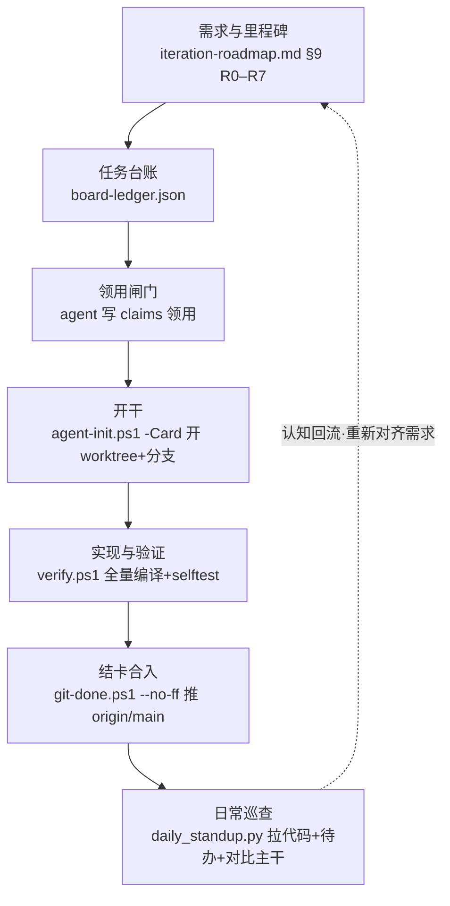

# NeonBoard 项目全景地图（Onboarding）

> 给「第一次接触本项目」的人看的上手地图：项目是啥、怎么切、活怎么流、规矩红线、当前进度、agent 能帮你干啥、你怎么上手。
> 维护方式：随项目演进更新；重大里程碑变动（如新增 R8）请同步 §2 与 §5。

## 1. 这个项目是啥

NeonBoard 是一个 **Qt/QML + C++ 的桌面任务看板**应用，主打"炫酷"体验（动效、主题引擎、Shader 场景化）。
它的核心演进方向是 **任务派发器**：让 agent 能一键把一张"任务卡"真正跑起来，并给出可验证的结论。
你看到的 R0–R7 里程碑，就是奔着「看板 → 可派发 agent 执行的任务系统」去的。

## 2. 项目怎么切（两层）

### 2.1 里程碑 R0–R7（路线图里的"版本/阶段"）

| 版本 | 主题 | 主干状态 | 一句话 |
|------|------|----------|--------|
| R0 | 炫酷地基 | 完成 | 启动瘦身、主题引擎 v1、动效基线 |
| R1 | 日常底座 | 完成 | 提醒/逾期、RRULE、子任务、导入导出、Ctrl+K、撤销 |
| R2 | 记忆点 | 核心完成 | Shader 场景化、专注模式、统计可视化 |
| R3 | 生态 | 基本完成 | 插件平台 2.0 + 在线市场 + 热重载 |
| R4 | 工程化底座 | 完成（台账 baseline 陈旧） | Agent 任务桥、Windows 集成、多板、数据可靠性、CI、构建提速、任务治理 |
| R5 | 交付与运维 | 完成（R5-05 漂移） | 自动更新、单测 9/9 |
| R6 | 任务派发器 | 部分完成（3/9） | 执行定义、run 表+锁、Profile+确认、单次执行器、验收器、面板、Triage、Loop |
| R7 | 派发器进阶 | 规划中（6 卡已登记） | 队列编排 + 多 Agent 角色链（承接 R6 推迟的 M2–M4） |

详细计划： `docs/r6-dispatcher-plan.md`、`docs/r7-dispatcher-plan.md`；主干声明见 `docs/iteration-roadmap.md` §9。

### 2.2 任务卡（ledger）

每张具体工作 = 一张卡，全部在 `docs/board-ledger.json`：
- `cards`：短号（`R6-01`）、标题、`acceptance[]`（验收命令）、`scope[]`（改动范围）、`depends[]`（依赖）
- `baseline`：卡片初始状态种子（⚠️ 多处陈旧，真实状态以 git 提交里的 `#短号=done` 标记为准）
- `claims`：谁领用了哪张卡（agent 只能写这里）

## 3. 全链路（从需求到合入）

步骤拆解：
1. **需求** → `docs/iteration-roadmap.md` §9（+ `r6/r7-dispatcher-plan.md`）
2. **台账** → `board-ledger.json` 登记卡
3. **领用** → agent 在 `claims` 声明要干这张卡（双领防护，防抢）
4. **开干** → `agent-init.ps1 -Card <短号>` 开 worktree + `feature/<简述>` 分支
5. **验证** → `verify.ps1`（全量编译 + selftest 退出 0）
6. **合入** → `git-done.ps1`（--no-ff 合并，快进推 `origin/main`）
7. **日常巡查** → `daily_standup.py`（拉代码 + 分析待办 + 对比主干漂移）

## 4. 宪章红线（AGENTS.md 摘要）

- **不在 `main` 直改直提**：纯文档走 `docs/<描述>` 分支，代码走 `feature/<简述>` 分支
- 提交信息 `<type>(<scope>): 中文简述`；纯文档用 `docs(roadmap):`
- **任务先行**：所有改动必须对应一张已领用的卡，无卡改动会被闸门拦
- **agent 不能自作主张加卡**（那是自授权，闸门退化成自证）；但**维护者显式授权 → agent 可代登记**
- agent 只能写 `claims`（领用）+ `note`（交付说明），不能写 `cards`/`baseline`
- "提上去"的合规路径：`git-done.ps1` 远程模式做 --no-ff 合并 + 快进推 `origin/main`

## 5. 当前真实进度（基于 daily_standup + git 标记核实）

台账共 **72 张卡**。注意：`baseline` 是陈旧种子，真实状态看 git 提交里的 `#短号=done` 标记。
- **R0–R4 基本做完**：R4 全 10 张有 git done 标记，但台账 `baseline` 仍 todo（陈旧）
- **R5 宣称 done，但 `R5-05` 仍 todo**（漂移，待维护者回填）
- **R6 派发器 3/9 已 done**（R6-01/02/03，引擎骨架就绪），正等 **R6-04 单次执行器**这个 MVP 分水岭
- **R7 派发器进阶 6 张卡刚登记**（全 todo），是 R6 收口后的下一步

⚠️ 坑：`baseline` 多处陈旧（R4 全量、R5-05、R6 的 3 张），功能上 git 标记已覆盖，但"对比主干"会误报，需维护者回填。

## 6. agent（WorkBuddy）能帮你干啥

- **日常开发技能**（`.workbuddy/skills/neonboard-daily-dev/`）：说"日常开发"→ 拉代码+分析待办+对比主干
- **代登记卡片**（你授权后）：像 R7 那样追加进 ledger
- **开干一张卡**：你给卡号 → `agent-init` 开 worktree → 实现 → `verify` → `git-done` 合入
- 写/改文档（路线图、计划）、逐文档带读讲解

## 7. 上手三步走

1. **读三份建立认知**（几分钟）：`README.md`（定位）、`AGENTS.md`（宪章红线）、`docs/iteration-roadmap.md`（§9 主干）
2. **跑一次日常技能看活**：直接说"日常开发"，把待办和主干对比拉给你
3. **挑方向**：要么推进 **R6-04**（给 R7 打地基，依赖已就绪），要么让我逐文档带读

## 8. 关键文档索引

- 宪章：`AGENTS.md`
- 里程碑需求：`docs/iteration-roadmap.md`（§9 主干）
- 派发器计划：`docs/r6-dispatcher-plan.md`、`docs/r7-dispatcher-plan.md`
- 台账：`docs/board-ledger.json`
- 工作流细节：`docs/git-workflow.md`、`docs/task-card.md`
- 日常技能：`.workbuddy/skills/neonboard-daily-dev/SKILL.md`
